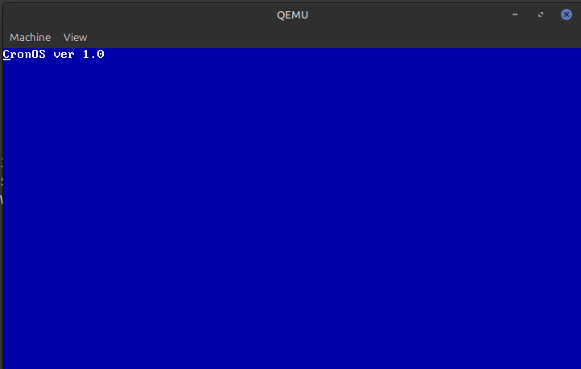

# CronOS

CronOS is a tiny toy operating system project built for fun and experimentation.

At the moment, CronOS contains only a minimal x86 bootloader. It is a 512-byte boot sector written in 16-bit assembly that can be loaded by a BIOS-compatible emulator. When it starts, it initializes the basic segment registers and stack, switches to VGA 80x25 color text mode, paints the screen white-on-blue, writes a short startup message directly to VGA text memory, and then halts the CPU.



## Current Status

- 16-bit x86 bootloader
- VGA 80x25 color text mode setup through BIOS video services
- Direct text output through VGA memory at `0xB800`
- White-on-blue startup screen
- Boot sector signature `0xAA55`
- Runs as a raw floppy image in QEMU

There is no kernel, shell, filesystem, driver layer, memory manager, or process system yet. For now, CronOS is just the first bootable spark of a small operating system experiment.

## Project Structure

```text
CronOS/
  boot.asm        Bootloader source code

compile_os.sh     Builds the boot sector into boot.bin
run_in_qemu.sh    Runs boot.bin in QEMU
s_img/            Screenshots and images
```

## Build

Requirements:

- `nasm`
- `qemu-system-i386`

Build the boot sector:

```bash
./compile_os.sh
```

This creates `boot.bin`, a raw 512-byte boot sector image.

## Run

Start CronOS in QEMU:

```bash
./run_in_qemu.sh
```

You should see:

```text
CronOS ver 1.0
```

The text appears in the top-left corner on a blue VGA text-mode screen.

## License

See [LICENSE](LICENSE).
